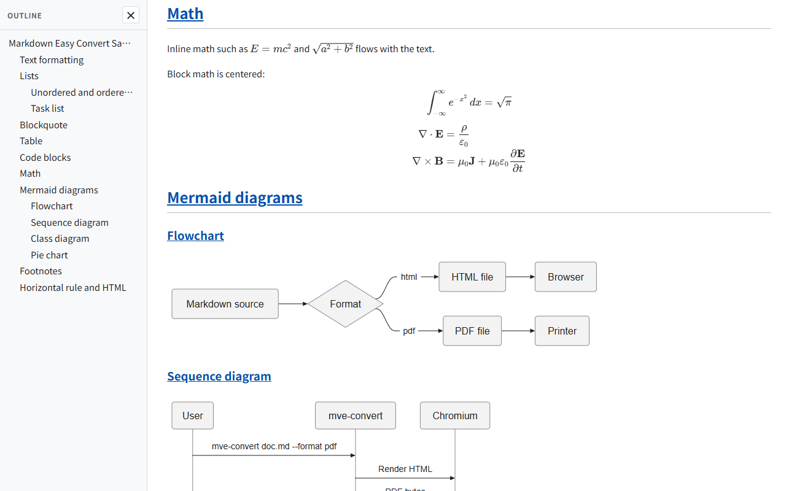
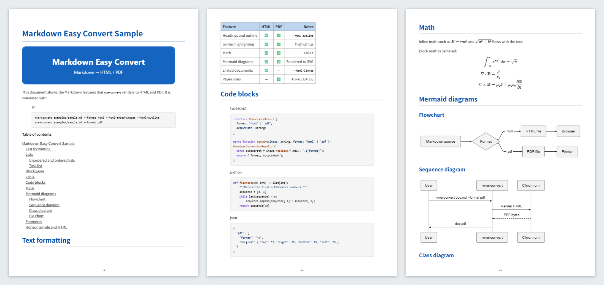

# Markdown Easy Convert

`mve-convert` is a command-line tool that converts Markdown and Textile documents to HTML or PDF. The input document is never modified.

- Headings, lists, task lists, tables, footnotes, and a `[toc]` table of contents
- Syntax-highlighted code blocks
- Math with KaTeX (`$...$` and `$$...$$`)
- Mermaid diagrams rendered to SVG; in regular documents and Marp slide decks, a diagram that cannot be rendered (for example, a syntax error) is replaced by an error message, the rest of the document is still exported, and a warning is written to stderr (exit code 0)
- Marp slide decks (PDF output only; HTML output renders the slide source as a regular document)
- HTML with an optional heading outline sidebar, embedded images, and recursive conversion of linked documents
- PDF paper sizes `A0`–`A6`, `B4`, and `B5`, with configurable margins, fonts, headers, and footers

## Requirements

- Node.js 22, 24, or 26
- Microsoft Edge, Google Chrome, or another Chromium-based browser

The browser is not installed with the package. By default, `mve-convert` looks for Edge and then Chrome. Use `--browser` to choose another executable.

## Install

```sh
npm install --global @metrosoft/markdown-easy-converter
mve-convert --help
```

## Quick start

```sh
# Writes document.html next to document.md
mve-convert document.md --format html

# Writes document.pdf next to document.md
mve-convert document.md --format pdf

# Chooses the output path and overwrites an existing file
mve-convert document.md --format pdf -o out/document.pdf --force

# --format can be omitted when -o ends in .html, .htm, or .pdf
mve-convert document.md -o out/document.pdf

# Converts many documents with one browser, keeping their relative locations
mve-convert "docs/**/*.md" --format pdf --out-dir dist

# Reads standard input and writes standard output
cat document.md | mve-convert - --format html --base-dir . > document.html
```

## Example

HTML output of [examples/sample.md](examples/sample.md) with the heading outline:



PDF output:



## Options

| Option | Description | Default |
| --- | --- | --- |
| `--format html\|pdf` | Output format. Required unless `-o` ends in `.html`, `.htm`, or `.pdf`. | — |
| `-o, --output PATH` | Output file path. Missing directories are created. `-` writes to standard output. | Input path with `.html` or `.pdf` |
| `--out-dir PATH` | Output directory. Inputs keep their locations relative to their common parent directory. Cannot be combined with `-o`. | — |
| `--base-dir PATH` | Base directory for relative links when reading standard input. | Current directory |
| `--title TEXT` | Document title. Applies to a single input. | See [Document title and front matter](#document-title-and-front-matter) |
| `--css PATH` | CSS file added after the built-in styles, for HTML and PDF. Can be repeated, and replaces `rendering.css`. The file is inlined, so relative `url()` references are not resolved from its location; use `data:` or absolute `https:` URLs. | — |
| `--strict` | Exit with code 1 when any warning is reported. Output files are still written. | Off |
| `--json` | Write the result to standard output as JSON. See [Scripting](#scripting). | Off |
| `--restrict-local-files` | Do not read images or linked documents outside the workspace root. | Off |
| `--front-matter auto\|render` | `auto` removes YAML front matter from the output. `render` keeps it in the document. | `auto` |
| `--browser-timeout SEC` | Browser startup timeout in seconds, up to 3600. | `5` |
| `--render-timeout SEC` | PDF generation timeout in seconds, up to 3600. | `60` |
| `--config PATH` | JSON configuration file. See [Configuration file](#configuration-file). | — |
| `--force` | Overwrite existing output files. | Off |
| `--browser PATH` | Browser executable used for rendering. | Edge, then Chrome |
| `--language CODE` | Language of generated labels (outline, table of contents, copy button) and the HTML `lang` attribute: `ja`, `en`, `zh-cn`, `ko`, `fr`, `de`, or `es`. Document text is not translated. | `en` |
| `--theme light\|dark` | Heading color. `light` uses a brighter blue, `dark` a deeper blue. | `dark` |
| `--mermaid-theme NAME` | Mermaid theme: `auto`, `default`, `dark`, or `neutral`. | `auto` |
| `--workspace-root PATH` | Base directory for links that start with `/`. | Input directory |
| `--html-embed-images` | Embed local images in the HTML file. | Off |
| `--html-no-embed-images` | Keep relative image paths in the HTML file. | On |
| `--html-outline` | Add a heading outline sidebar to the HTML file. | Off |
| `--html-linked` | Also convert linked Markdown and Textile documents. | Off |
| `-h, --help` | Show usage. | — |
| `--version` | Show the package version. | — |

Options that start with `--html-` apply only to HTML output; combining them with `--format pdf` is an error. Command-line options take precedence over the configuration file.

### Converting linked documents

With `--html-linked`, `mve-convert` follows links to other Markdown and Textile documents and converts each one to HTML:

- Linked documents are written to the same relative location in the output directory. Documents outside the input directory are written under `_linked/`.
- If any output file already exists, the conversion fails unless `--force` is set. With `--force`, all outputs can be overwritten.
- Two different source documents cannot share one output path, even with `--force`.

## Converting many documents

Pass several files or quoted wildcard patterns. `*` and `?` match within one path segment and `**` matches any number of directories. Patterns select only `.md`, `.markdown`, and `.textile` files, and wildcards skip hidden files, hidden directories, and `node_modules`. A file that exists under the exact name given is never treated as a pattern. A pattern that matches nothing is an error with exit code 1.

With `--out-dir`, locations are relative to the part of each pattern before the first wildcard, or to the parent directory of a file. `docs/**/*.md` writes `docs/sub/a.md` to `sub/a.pdf` inside the output directory.

- All documents share one browser, so converting many files is much faster than running `mve-convert` once per file.
- If one document fails, the others are still converted, and the exit code is 1.
- If two inputs would write the same output file, nothing is written.
- `-o`, `--title`, standard output, and `--html-linked` work with a single input only.

## Document title and front matter

A YAML front matter block at the start of a Markdown document is not written to the output. A leading block between `---` lines is treated as front matter only when it parses as a YAML mapping (`key: value`); anything else stays in the document. In `.textile` files, only a block with `marp: true` is removed. To keep the block in the output as in earlier versions, set `rendering.frontMatter` to `render`.

The HTML `<title>` and the PDF document title come from `--title`, then the front matter `title`, then the first level-1 heading, then the file name. `textReplacements` also apply to the title.

## Local images

`--html-embed-images` and PDF output embed a local file only when its content is an image, whatever its name: PNG, JPEG, GIF, WebP, BMP, ICO, or AVIF, or, for files named `.svg`, a document whose first element is `svg`. Other files are not embedded, and a warning is written to stderr (exit code 0).

Directories are not restricted by default. Use `--restrict-local-files` when converting untrusted documents; it limits images and `--html-linked` documents to `--workspace-root` (the input directory by default), and on Windows it refuses network paths without connecting to them. Without `--html-embed-images`, HTML output only references images: it checks that a local image exists so that a missing one can be reported, and it does not read the image or check network paths.

## Scripting

| Exit code | Meaning |
| --- | --- |
| `0` | Success. Warnings may have been written to stderr. |
| `1` | A conversion failed, `--strict` found warnings, or the configuration has an unknown key inside `pdf` or `html`. |
| `2` | Invalid arguments or other invalid configuration. |
| `130` | Interrupted. |

Without `--json`, standard output lists the written files, one per line. With `--json`, it contains one JSON object:

```json
{
  "ok": true,
  "results": [
    { "input": "/docs/a.md", "outputs": ["/docs/a.pdf"], "warnings": [] }
  ]
}
```

A failed or interrupted input also has an `error` string. If no conversion started, for example because of invalid arguments, the object has a top-level `error` string instead. Warnings are written to stderr in both modes.

## Configuration file

Pass a JSON file with `--config`. All keys are optional, and unknown keys or invalid values are reported as errors. Relative `browserPath` and `workspaceRoot` values are resolved from the configuration file's directory.

```json
{
  "rendering": {
    "remoteImagesEnabled": false
  },
  "html": {
    "embedImages": true,
    "showOutlineSidebar": true
  },
  "pdf": {
    "format": "A4",
    "orientation": "portrait",
    "margins": { "top": 15, "right": 15, "bottom": 15, "left": 15 },
    "header": "Project report",
    "footer": "{page}/{pages}"
  }
}
```

```sh
mve-convert document.md --format pdf --config export.json
```

### Top level

| Key | Description |
| --- | --- |
| `browserPath` | Same as `--browser`. |
| `workspaceRoot` | Same as `--workspace-root`. |

### `rendering`

| Key | Values | Default |
| --- | --- | --- |
| `renderFormat` | `auto`, `markdown`, `mixed`, or `textile`. `auto` treats `.textile` files as Textile and other files as Markdown with Textile syntax allowed (`mixed`). | `auto` |
| `remoteImagesEnabled` | `false` hides remote images written with Markdown or Textile image syntax. It does not block other network requests. | `true` |
| `language` | Same as `--language`. | `en` |
| `editorTheme` | Same as `--theme`. | `dark` |
| `mermaidTheme` | Same as `--mermaid-theme`. | `auto` |
| `mermaidFontSize` | Mermaid diagram font size, 8–48. | Mermaid default |
| `previewFontFamily` | CSS font stack for HTML text and Mermaid diagrams. | Noto Sans JP stack |
| `frontMatter` | `auto` removes YAML front matter from the output. `render` keeps it in the document. | `auto` |
| `restrictLocalFiles` | Same as `--restrict-local-files`. | `false` |
| `css` | Path or array of paths, relative to the configuration file. Same as `--css`. | — |
| `browserTimeout` | Same as `--browser-timeout`. | `5` |
| `renderTimeout` | Same as `--render-timeout`. | `60` |

### `html`

| Key | Description | Default |
| --- | --- | --- |
| `embedImages` | Same as `--html-embed-images`. | `false` |
| `showOutlineSidebar` | Same as `--html-outline`. | `false` |
| `convertLinkedMarkdown` | Same as `--html-linked`. | `false` |

### `pdf`

Out-of-range numbers are clamped to the listed range.

| Key | Description | Default |
| --- | --- | --- |
| `format` | `A0`, `A1`, `A2`, `A3`, `A4`, `A5`, `A6`, `B4`, or `B5`. | `A4` |
| `orientation` | `portrait` or `landscape`. | `portrait` |
| `margins` | `top`, `right`, `bottom`, and `left` in millimeters, 0–50, rounded to whole millimeters. | 15 each |
| `header` | Text at the top of each page. `{page}` and `{pages}` are replaced with the page number and the page count, `{title}` with the document title, `{file}` with the input file name, and `{date}` with the local date as `YYYY-MM-DD`. | Empty |
| `footer` | Text at the bottom of each page, with the same placeholders. | `{page}/{pages}` |
| `headerAlign` | `left`, `center`, or `right`. | `left` |
| `footerAlign` | `left`, `center`, or `right`. | `center` |
| `headerFooterFontSize` | Header and footer text size in points, 4–24. | `6` |
| `headerFooterPadding` | Header and footer left and right padding in millimeters, 0–50. | `15` |
| `fontFamily` | CSS font stack for body text. | Noto Sans JP stack |
| `bodyFontSize` | Body text size in points, 6–48. | `11` |
| `headingFontSizes` | `h1`–`h6` sizes in points, 6–72. | 24, 20, 16, 14, 12, 11 |
| `codeFontSize` | Code size in points, 6–36. | `9` |
| `lineHeight` | Line height multiplier, 0.8–3. | `1.6` |
| `paragraphSpacing` | Space after paragraphs in points, 0–48. | `6` |
| `textReplacements` | Array of `{ "pattern": "...", "replacement": "..." }`. Each `pattern` is a regular expression applied to every match in the output text. `replacement` is inserted literally. Also applies to HTML output and the document title. This does not guarantee redaction: the HTML outline sidebar, heading anchors, and Mermaid source attributes keep the original text. | `[]` |

## Troubleshooting

**No browser is found or it fails to start.** The error message lists the reason reported for Edge and for Chrome. If neither is installed, install one of them or pass the path of a Chromium-based browser:

```sh
# Windows
mve-convert document.md --format pdf --browser "C:\Program Files\Google\Chrome\Application\chrome.exe"
# macOS
mve-convert document.md --format pdf --browser "/Applications/Google Chrome.app/Contents/MacOS/Google Chrome"
# Linux
mve-convert document.md --format pdf --browser /usr/bin/chromium
```

On Linux, an installed browser can also fail to start because of missing system libraries. See the [Playwright browser requirements](https://playwright.dev/docs/browsers).

## License

[MIT](LICENSE.md). License texts of bundled third-party packages are included in `dist/third-party-licenses/`.
