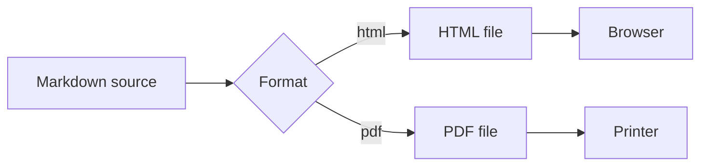
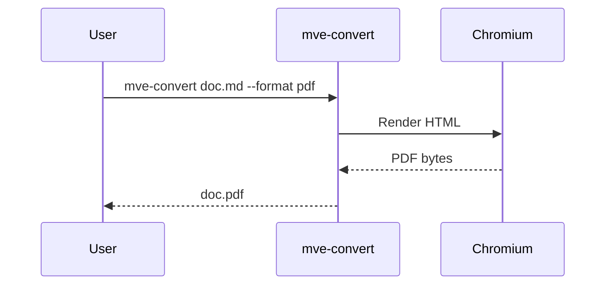
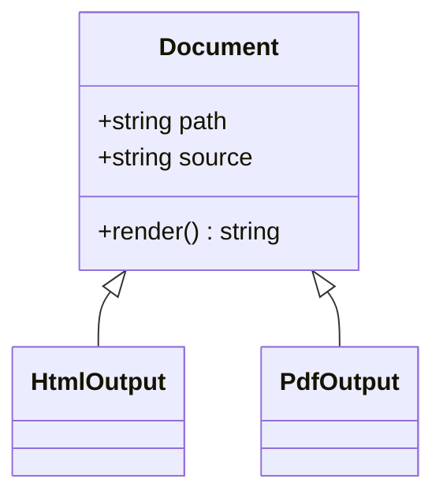
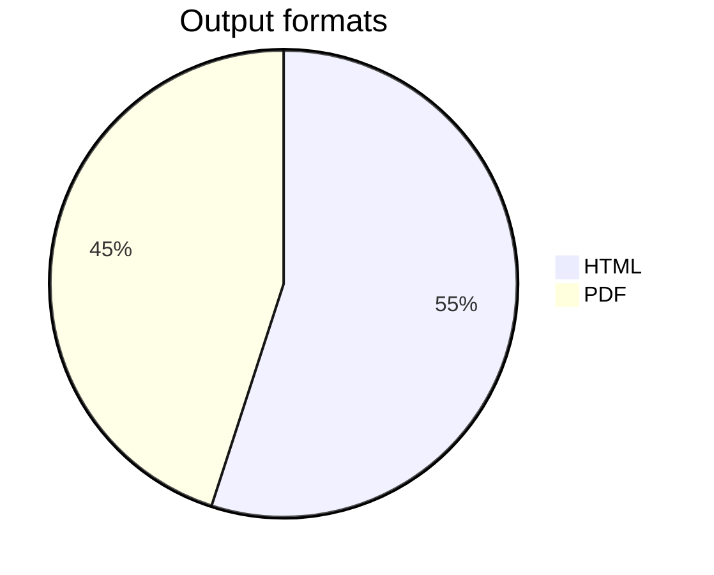

# Markdown Easy Convert Sample


This document shows the Markdown features that `mve-convert` renders to HTML and PDF. It is converted with:

```sh
mve-convert examples/sample.md --format html --html-embed-images --html-outline
mve-convert examples/sample.md --format pdf
```

[toc]

## Text formatting

Paragraphs can mix **bold**, *italic*, ***bold italic***, ~~strikethrough~~, `inline code`, and [links](https://github.com/MetroSoft-Application/markdown-easy-converter).
Extended inline syntax adds ==highlighted text==, ++inserted text++, superscript such as x^2^, and subscript such as H~2~O.

Autolinks work too: <https://www.npmjs.com/>.

Unicode text is preserved: 日本語のテキスト, 한국어, Ελληνικά, emoji 🎉.

## Lists

### Unordered and ordered lists

- Write documents in Markdown
- Convert them from the command line
  - HTML for the web
  - PDF for printing and sharing
- Keep the source file unchanged

1. Install the package
2. Run `mve-convert`
3. Open the generated file
   1. Check the layout
   2. Share it

### Task list

- [x] Headings and paragraphs
- [x] Tables and code blocks
- [x] Math and diagrams
- [ ] Your own document

## Blockquote

> Markdown is intended to be as easy to read and easy to write as is feasible.
>
> > Nested quotes are supported, and **formatting** works inside them.

## Table

| Feature | HTML | PDF | Notes |
| :--- | :---: | :---: | ---: |
| Headings and outline | ✅ | ✅ | `--html-outline` |
| Syntax highlighting | ✅ | ✅ | highlight.js |
| Math | ✅ | ✅ | KaTeX |
| Mermaid diagrams | ✅ | ✅ | Rendered to SVG |
| Linked documents | ✅ | — | `--html-linked` |
| Paper sizes | — | ✅ | A0–A6, B4, B5 |

## Code blocks

```typescript
interface ConversionResult {
  format: 'html' | 'pdf';
  outputPath: string;
}

async function convert(input: string, format: 'html' | 'pdf'): Promise<ConversionResult> {
  const outputPath = input.replace(/\.md$/, `.${format}`);
  return { format, outputPath };
}
```

```python
def fibonacci(n: int) -> list[int]:
    """Return the first n Fibonacci numbers."""
    sequence = [0, 1]
    while len(sequence) < n:
        sequence.append(sequence[-1] + sequence[-2])
    return sequence[:n]
```

```json
{
  "pdf": {
    "format": "A4",
    "margins": { "top": 15, "right": 15, "bottom": 15, "left": 15 }
  }
}
```

## Math

Inline math such as $E = mc^2$ and $\sqrt{a^2 + b^2}$ flows with the text.

Block math is centered:

$$
\int_{-\infty}^{\infty} e^{-x^2}\,dx = \sqrt{\pi}
$$

$$
\begin{aligned}
\nabla \cdot \mathbf{E} &= \frac{\rho}{\varepsilon_0} \\
\nabla \times \mathbf{B} &= \mu_0 \mathbf{J} + \mu_0 \varepsilon_0 \frac{\partial \mathbf{E}}{\partial t}
\end{aligned}
$$

## Mermaid diagrams

### Flowchart



### Sequence diagram



### Class diagram



### Pie chart



## Footnotes

Markdown Easy Convert uses Chromium for rendering[^1], and math is typeset with KaTeX[^2].

[^1]: Microsoft Edge or Google Chrome is detected automatically. Another executable can be selected with the browser option.
[^2]: KaTeX renders TeX math expressions without a network connection.

## Horizontal rule and HTML

Content above the rule.

---

<details>
<summary>Raw HTML such as <code>&lt;details&gt;</code> is supported</summary>

Raw HTML is sanitized with DOMPurify before rendering.

</details>

<kbd>Ctrl</kbd> + <kbd>S</kbd> saves the document.
